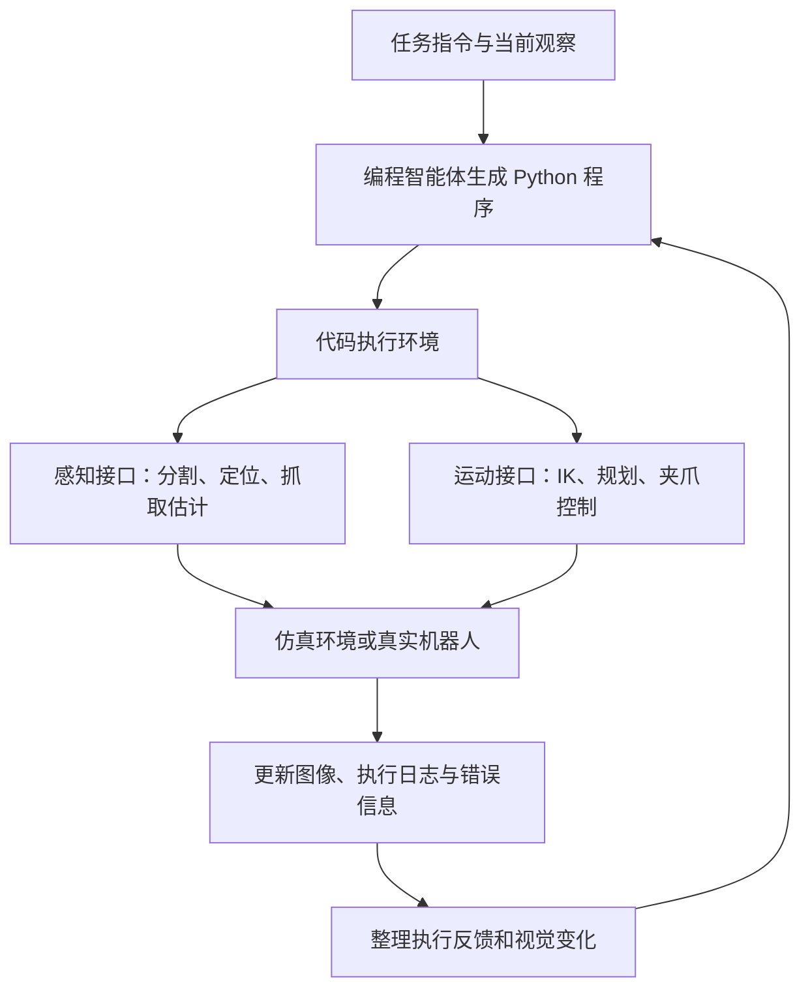

# Letian Fu 博士论文中文导读：轨迹预训练、合成数据与 CaP-X

> 原文件：[202605 Cap-X PhD Thesis Letian Fu Berkeley.pdf](<./202605 Cap-X PhD Thesis Letian Fu Berkeley.pdf>)  
> 本文根据本地 PDF 整理，是面向理解的中文导读，并非逐字翻译。实验数字均指论文报告的结果；文中的直观例子和工程启发会单独标明。

## 1. 这份文件是什么？

这是一份加州大学伯克利分校的计算机科学博士学位论文，作者是 **Letian Fu**，导师／答辩委员会主席为 **Ken Goldberg**。论文封面标注 Spring 2026，技术报告日期为 2026 年 5 月 12 日，编号为 UCB/EECS-2026-118。

正式标题是：

**Towards Efficient and Scalable Robot Learning: Trajectory Pre-training, Synthetic Data, and Coding Agents**

可以译为：**《迈向高效、可扩展的机器人学习：轨迹预训练、合成数据与编程智能体》**。

PDF 共 **254 页**，包含正文、附录和参考文献。文件名虽然突出 Cap-X，但 **CaP-X 只是第 10 章的研究项目**。整篇博士论文把多个相关研究串联起来，讨论一个共同问题：

**机器人怎样才能以更少的人工示范、更低的数据成本，学会更多任务，并适应新物体、新场景和不同机器人？**

## 2. 先用几分钟理解全篇

语言模型可以使用大量文本训练，机器人却需要“观察—动作—结果”这种物理交互数据。采集这些数据涉及真实硬件、操作时间、场景复位和不同机器人之间的差异，难以直接照搬互联网数据的规模化方式。

作者沿三个互补方向解决这个问题：

| 方向 | 核心问题 | 论文中的工作 | 通俗理解 |
|---|---|---|---|
| 轨迹预训练 | 怎样更充分地利用已有经验？ | RPT、ICRT、OTTER | 让机器人从完整的操作过程学习，并理解示范和语言 |
| 数据生成 | 怎样降低获得训练数据的成本？ | 自监督插接、Real2Render2Real | 让机器人自动采集，或者从少量现实输入生成大量数据 |
| 智能体控制 | 怎样使用通用模型的推理和编程能力？ | CaP-X | 让模型写程序调用机器人能力，观察结果后继续修正 |

**这三条路线可以组合使用。** 例如，编程智能体负责拆解任务、选择工具和处理失败，学习得到的策略负责执行抓取等动作，传统控制器负责具体运动与力控制。这是论文提出的有前景的方向，并非全文已经验证了一个统一系统。

## 3. 阅读前需要认识的概念

| 概念 | 在这篇论文中的含义 |
|---|---|
| 轨迹（Trajectory） | 随时间排列的观察、机器人状态和动作，例如“看到杯子→靠近→夹住→提起” |
| 本体感知（Proprioception） | 机器人自身的状态，如关节角、末端位置、夹爪开合程度 |
| 策略（Policy） | 根据当前输入决定动作的规则或模型 |
| 模仿学习（Imitation Learning） | 使用已有示范学习如何行动 |
| 预训练／后训练 | 先从较广泛数据中学习，再针对下游任务或能力进行适配 |
| 上下文学习（In-context Learning） | 执行时把示范作为输入，通过上下文适应任务，不更新模型权重 |
| VLM | 视觉语言模型，可以处理图像与文字 |
| VLA | 视觉语言动作模型，根据视觉、语言及机器人状态等输入预测动作 |
| 遥操作（Teleoperation） | 人操控机器人完成动作，同时记录训练数据 |
| 具身／机器人形态（Embodiment） | 实际身体及其动作接口，例如单臂、双臂、移动底盘和不同夹爪 |
| Primitive | 可调用的基础能力，例如图像分割、抓取规划、逆运动学、打开夹爪 |
| 逆运动学（IK） | 给定末端目标位置和朝向，求机器人关节应如何配置 |
| 闭环控制 | 执行后重新观察，根据实际结果修正后续动作 |
| Agent harness | 围绕模型搭建的执行系统，包括工具、反馈、记忆、技能库和调度 |
| 推理时计算（Test-time compute） | 在执行任务时投入更多模型调用、候选生成和反馈推理 |
| Sim-to-Real | 把仿真中获得的能力迁移到真实机器人 |
| RLVR | 使用可验证奖励的强化学习，例如通过环境判断物体是否成功被提起 |

## 4. 第一部分：怎样从机器人轨迹中学习？

### 4.1 RPT：把机器人操作过程做成“填空题”

**位置：第 3 章，正文第 11–23 页。**

输入是一串相机图像、机器人自身状态和动作：

```text
图像1、状态1、动作1 → 图像2、状态2、动作2 → ……
```

训练时随机遮住部分内容，要求 Transformer 根据其余内容预测缺失项。图像部分主要在视觉特征空间中预测，并非重画整张图像。

直观类比：看到“夹爪靠近物体—中间缺失—物体被提起”，模型需要学习中间动作与前后状态的关系。它也可以利用动作和其他时刻的信息推断被遮住的状态。

预训练完成后，可以微调整个模型，也可以冻结模型，只训练一个简单的动作输出层。后者用于检验学到的表示本身是否有用。

**要理解的贡献：** 机器人预训练不应只学习“图像里是什么”，还应学习视觉、自身状态、动作之间的时间关系。论文在抓取、分拣和堆叠等设置中研究了迁移和数据效率。

**边界：** 能够预测轨迹片段，并不等于已经掌握任意物理规律或任意机器人任务。

### 4.2 ICRT：把示范轨迹当作任务提示

**位置：第 4 章，正文第 24–36 页。**

ICRT 研究：给机器人看一段或几段示范，能不能不再更新权重，就完成相应任务？

```text
示范轨迹 + 当前观察与机器人状态 → 模型预测动作 → 执行并更新观察
```

这里的示范包含机器人传感器状态和动作，不能简单理解为任意一段普通视频。主方法使用因果 Transformer 处理连续的状态和动作表示；“next-token prediction”也不意味着输出一定是文字。

一个重要的数据设计是：**同一个场景应存在多个可能任务，让模型必须参考示范才能判断要做什么。** 如果每个场景永远只有一个任务，模型可能忽略示范，只根据当前画面猜动作。

论文为此采集了 ICRT-MT，包含 **1,098 条轨迹、29 个任务**。第 4 章表 4.2 的消融实验中，完整 ICRT 的平均成功率为 **79.2%**，仅使用筛选后的 DROID 子集训练的版本为 **0%**。

这个对比强调的是特定评测中**数据组织方式的重要性**，不能解释成 DROID 数据集普遍无效。

**边界：** 对完全陌生动作原语的泛化尚不明确；研究假设固定机器人形态和控制器。“执行时不更新权重”也不等于模型此前没有训练。

### 4.3 OTTER：先根据语言找到该关注的视觉信息

**位置：第 5 章，正文第 37–52 页。**

机器人不仅要会动，还需要把“拿起那个红色杯子”中的文字对应到正确物体。

OTTER 利用预训练 CLIP 的视觉语言对齐能力，计算文字特征与图像局部特征的相似程度，从图像中提取与指令相关的视觉特征，再结合机器人自身状态预测动作。

```text
语言指令 + 相机图像
        ↓
提取与文字相关的视觉特征
        ↓
结合机器人状态与时间上下文
        ↓
预测一段后续动作
```

CLIP 在训练中保持冻结，策略网络等部分仍需要训练。核心思想是尽量利用已有视觉语言语义，而不把所有语义对应关系都交给较小的机器人数据集重新学习。

论文还使用带手部姿态标注的人类视频数据预训练。在表 5.5 的真实机器人实验中，未见任务成功率从 **62% 提升到 70%**；训练任务则为 **68% 和 67%**。这支持其对该设置下泛化的帮助，并非所有指标都提高。

**边界：** 多指手等不同形态、复杂长程任务和更复杂场景仍需进一步研究。

## 5. 第二部分：怎样减少人工采集数据？

### 5.1 自监督插接：通过触觉、视觉和力反馈自动采集

**位置：第 7 章，正文第 57–70 页。**

研究以 USB 插接为例。困难在于：即使机器人夹爪的位置相同，USB 在夹爪里也可能夹得有偏差，直接按固定轨迹插入容易失败。

方法从一个人工提供的插入目标姿态开始，使用力／力矩信息细化该姿态，再自动改变抓取姿态、采集数据。执行时分两阶段：

1. **触觉对齐：** 根据夹爪上的 DIGIT 触觉传感器估计连接器在夹爪中的姿态。
2. **视觉插入：** 用视觉反馈引导后续插入运动。

主要实验中，方法在测试的 **45 个抓取姿态上全部成功**；但这些抓取配置位于研究规定的测试分布内，且使用了细化后的目标姿态。

另一个加入目标位置噪声、并修改视觉策略的消融实验中，触觉与视觉结合取得 **40/45**，触觉单独为 **21/45**，受限视觉单独为 **8/45**。（第 7.5 节、表 7.4）

**要理解的贡献：** 通过任务结构、传感器反馈和自动复位，减少逐条人工示范的需求。

**边界：** 仍需要真实机器人、传感器和初始人工设置；它不是不需要硬件的合成数据方法，也尚未证明能推广到各种连接器和装配任务。

### 5.2 Real2Render2Real：从少量现实输入生成大量机器人示范

**位置：第 8 章，正文第 71–82 页。简称 R2R2R。**

输入主要包括手机拍摄的物体多视角扫描、一次人类操作视频，以及机器人 URDF 等必要配置。

流程可以理解为：

```text
扫描真实物体 + 拍摄人操作物体的视频
                   ↓
重建物体及其部件，提取物体运动
                   ↓
变化起始位置、视角、光照等条件
                   ↓
结合机器人模型，用 IK 生成机器人运动轨迹
                   ↓
批量渲染图像，并与动作配对形成训练数据
                   ↓
训练／微调动作策略，部署到真实机器人
```

其中使用 3D Gaussian Splatting 重建外观和几何，再转换为适合渲染的资产；使用 IsaacLab 并行渲染。**使用仿真软件渲染，不代表使用完整动力学仿真来求解物体接触过程。**

关键简化是：抓住物体之后，假设物体随设定的运动轨迹移动，通过运动学求出机器人的姿态，不必精确模拟摩擦、接触力和材料形变。

论文在 ABB YuMi 双臂机器人上的 5 个任务中评估了这些数据，包括拿玩具、放杯子、转水龙头、开抽屉和双臂提包裹，并训练 Diffusion Policy 与微调 π0-FAST。

几个值得记住的结果：

- 第 8.4 节报告单张 RTX 4090 平均生成约 **51 条示范／分钟**；数据生成时间图还计入了 **10 分钟设置成本**。
- 合成数据不一定每条都更有效。放杯子任务中，π0-FAST 使用 **150 条真实示范达到 73.3%**，使用 **150 条合成示范为 33.3%**，扩大到 **1,000 条合成示范达到 80.0%**。
- 因此它的价值主要在于便于扩大数据量，而不是每一条合成数据都优于真实数据。

**适用边界：** 当前主要针对桌面、准静态、刚体或关节物体的抓持式操作；不适合直接推论到布料、强动态动作和复杂接触。轨迹生成未显式考虑所有障碍碰撞，也依赖重建和跟踪质量。（第 8.3、8.7 节）

## 6. 第三部分重点：CaP-X 到底是什么？

**位置：第 10 章，正文第 87–102 页。**

CaP 指 **Code-as-Policy**，即通过程序表达机器人行为。CaP-X 是围绕这种控制方式建立的**环境、评测和能力改进框架**。

理解它时，可以把传统的“工程师写机器人程序”，替换为“编程模型生成程序，系统执行，再把结果交给模型继续处理”。

### 6.1 它由四个部分构成

| 组件 | 做什么 | 容易混淆的地方 |
|---|---|---|
| **CaP-Gym** | 把机器人环境封装成可交互的代码执行环境 | 是环境接口，不是动作预测模型 |
| **CaP-Bench** | 比较不同模型、API 抽象层级和反馈设置 | 是评测体系，不是训练算法 |
| **CaP-Agent0** | 用多轮反馈、技能库和并行推理增强现成模型 | 不更新模型权重，但有额外工具、系统设计和推理成本 |
| **CaP-RL** | 用环境奖励强化学习后训练编程模型 | 更新的是生成机器人代码的模型 |

### 6.2 CaP-Gym：模型生成的代码如何让机器人行动？

CaP-Gym 基于 Gymnasium 接口，连接两个层次：外层是有状态的代码执行循环，内层是仿真或真实机器人的运动执行循环。

**一次智能体交互轮次可以运行一段程序，而这段程序可能触发很多底层控制步。** 因此模型调用频率和机器人控制频率不是同一个概念。



纯文字版本：**观察 → 写代码 → 调用感知与控制接口 → 执行 → 获取反馈 → 改写后续代码。**

以下是帮助理解的伪代码，不是论文提供的可直接运行 API：

```python
observation = observe()
target = locate_object(observation, "red cube")
grasp = estimate_grasp(target)
move_to(grasp)
close_gripper()
lift()
# 下一轮依据重新观察的结果判断是否抓住，并决定后续行动。
```

模型需要组织感知、几何计算和动作逻辑；具体关节运动仍依靠控制接口实现。

论文称 CaP-Gym 整合了 **187 个任务**，来自 RoboSuite、LIBERO-PRO 和 BEHAVIOR。**主要 CaP-Bench 对比集中在 7 个核心任务**，并不代表全部 187 个任务都进行了同样规模的评测。

### 6.3 CaP-Bench：究竟在测模型的什么能力？

核心任务包括方块提起、方块堆叠、擦拭、插销、重新堆叠、双臂提起和双臂交接。论文描述主要比较 12 个模型，每个任务、每个评测层级执行 100 次试验。

它尤其关注：如果 API 已经帮模型封装了很多工作，成功究竟来自模型，还是来自人工设计的接口？

表 10.1 和第 10.3 节把评测拆成以下层级：

| 层级 | 接口与信息条件 | 主要考察什么 |
|---|---|---|
| S1 | 单轮，高层 API，可使用无噪声仿真状态 | 感知条件理想时的程序决策 |
| S2 | 单轮，高层 API，实际感知存在噪声 | 加入感知误差后的表现 |
| S3 | 单轮，低层 API，有使用示例 | 能否自己组合底层能力 |
| S4 | 单轮，低层 API，无使用示例 | 仅凭函数定义和文档编程的能力 |
| M1 | 多轮，高层 API，执行日志和错误反馈 | 能否检查状态、诊断和修正 |
| M2 | M1 加原始 RGB 画面 | 能否直接利用图像反馈 |
| M3 | 多轮，高层 API，加入视觉差分文字反馈 | 结构化视觉反馈是否更有效 |
| M4 | 多轮，低层 API及使用示例，加入视觉差分文字反馈 | 更灵活的接口结合反馈能否提升能力 |

评测使用 **Zero-Shot Pass@1**。这里允许单次试验内多轮互动，但不允许通过不断重置环境来重新抽取一次机会；每个试验是一次连续交互过程。它也不表示训练数据中绝对没有类似任务。

论文发现，较高层的 API 往往让任务更容易成功，但也会限制模型能表达的策略。低层 API 更灵活，同时更容易出现坐标变换、感知组合和运动逻辑错误。

### 6.4 CaP-Agent0：不改权重，怎样提升表现？

**第一项：视觉差分模块 VDM。**

VDM 使用视觉语言模型把场景及其变化转换为文字。首轮描述场景；后续轮次结合观察变化帮助模型理解动作结果。

解释性例子：“夹爪已经闭合，但红方块仍然在桌面上”，比仅有“程序没有报错”更接近机器人真正需要的反馈。这里的描述仍是模型估计，不能当作无误差的真值。

论文的该组实验中，直接加入原始图像的 M2 表现不如纯文字反馈 M1，而使用 VDM 的 M3 改善了表现。作者将其与图像和编程推理的对齐困难联系起来；这不是“图片输入普遍没有用”的结论。

**第二项：自动合成技能库。**

从成功执行的低层代码里抽取函数，让模型识别可复用、任务无关的逻辑，保存为后续可用的工具。当前实现包含 **9 个合成函数**，采用一次技能合成流程。论文讨论了进一步迭代扩展的可能性，不能把它当成已经实现无限自主学习。

**第三项：并行生成候选，再综合。**

每轮生成多个候选方案，再由中央编程智能体综合为最终执行代码。实验包括同一模型请求 9 次，或者 3 个模型各请求 3 次。

这是候选代码层面的并行推理，并非在一次 Pass@1 试验里重置物理环境去试 9 遍。

图 10.8 的平均成功率消融结果为：

| 设置 | 平均成功率 |
|---|---:|
| S3：单轮低层 API 基线 | 24% |
| M4：低层 API + 多轮视觉差分反馈 | 55% |
| 再加入技能库 | 59% |
| 再加入单模型并行候选 | 66% |
| 使用多模型并行候选 | 68% |

**“Training-free”在这里意味着不额外更新基础模型权重。** 系统仍使用已经训练好的模型、感知模块、控制工具和从成功执行中提取的技能，并投入更多推理计算。

论文称它在 7 个任务中的 4 个达到或超过人类专家基线。这里的基线是**专家编写的程序**，不是与现场操作的人类在所有条件下等价的比较；智能体还能使用多轮反馈与额外计算。

### 6.5 CaP-RL：用机器人执行结果训练编程模型

CaP-RL 使用 **Qwen2.5-Coder-7B-Instruct**，通过 **GRPO** 强化学习后训练，研究方块提起、方块堆叠和擦拭三个任务。

```text
模型生成程序 → 在环境中执行 → 得到任务奖励 → 更新代码生成模型
```

训练采用 S1 的特权状态接口，以减少感知噪声带来的奖励归因困难；仿真评估采用存在感知噪声的 S2，并测试真实机器人迁移。

表 10.4 报告：

| 任务与环境 | 原始模型 | CaP-RL 后训练后 |
|---|---:|---:|
| 仿真：提起方块 | 25% | 80% |
| 仿真：堆叠方块 | 4% | 44% |
| 仿真：擦拭 | 30% | 93% |
| 真机：提起方块 | 24% | 84% |
| 真机：堆叠方块 | 12% | 76% |

仿真每任务 100 次，真机每任务 25 次。结果支持“机器人环境奖励可以改进代码生成策略”，但尚不足以证明对各种机器人和任意新任务都能迁移。

### 6.6 它与 VLA 是什么关系？

| 对比项 | VLA 路线 | CaP 编程智能体路线 |
|---|---|---|
| 主要输出 | 机器人动作或动作片段 | 可执行程序 |
| 行为来源 | 从机器人等数据中学习动作规律 | 基础模型推理与编程，加上感知和控制工具 |
| 适合发挥的能力 | 连续视觉动作映射、学习到的操作技能 | 任务拆解、工具组合、条件逻辑和失败恢复 |
| 主要困难 | 数据成本、分布变化、跨任务与跨形态泛化 | 感知错误、程序错误、执行延迟、工具能力限制 |

论文不是在论证 CaP 已全面胜过 VLA。表 10.2 的 LIBERO-PRO 扰动实验中，CaP-Agent0 的平均成功率仍只有 **12%–26%**。例如 libero-goal 的位置扰动下，π0.5 为 **38%**，CaP-Agent0 为 **26%**；指令扰动下两者为 **0%** 和 **17%**。

这些数字说明它在特定泛化维度上有优势，同时绝对成功率仍然不高。附录 E.9 还描述了物体分割混淆、抓取姿态不佳和碰撞等失败。

作者提出的后续方向是 **CaP–VLA 混合系统**：编程智能体处理任务逻辑和恢复，动作策略处理适合它的底层操作。（第 10.7、11.2 节）

## 7. 最容易误读的地方

| 看到的表述 | 更准确的理解 |
|---|---|
| “这是一篇 Cap-X 论文” | 这是覆盖多项研究的博士论文，CaP-X 是其中一章 |
| “给机器人看一个示范就会了” | ICRT 已经训练过；执行时用符合输入格式的轨迹作为上下文 |
| “不需要机器人硬件” | R2R2R 的合成数据生成无需真实机器人执行每条轨迹，真机验证仍需硬件 |
| “不需要动力学仿真” | 依然需要几何、机器人模型和渲染，并且牺牲了部分物理过程建模 |
| “Agent0 无需训练” | 不做额外权重训练，依然依赖预训练模块、工具、技能库和推理计算 |
| “模型直接控制机器人” | 在 CaP-X 中主要通过生成代码调用感知和控制接口 |
| “接近人类水平” | 特定任务上接近专家程序基线，不能推广到所有机器人操作 |
| “代码能运行就是成功” | 程序执行成功与物理任务完成是不同指标 |
| “187 个任务都表现很好” | 187 是环境覆盖数量，核心模型评测与扩展实验分别使用子集 |

## 8. 放到机器人仿真项目中，怎样理解它的用途？

以下是基于论文的工程启发，**不是对当前 `robot_sim` 或 `lerobot` 代码仓库的实现审查，也不是已经验证的复现方案**。

如果你关注“训练一个能抓取的策略”，第一、二部分更直接相关：它们研究输入表示、示范数据组织和合成训练数据。

如果你关注“让语言模型指挥仿真机器人做任务”，CaP-X 更直接相关。可以用下面五个问题理解自己的系统需要什么：

1. **模型能看到什么？** 仿真真值、RGB-D 图像，还是感知模块输出的目标位置？这决定评测难度。
2. **模型能调用什么？** 只提供运动和感知原语，还是已经提供完整抓取技能？这决定能力边界。
3. **如何执行代码？** 需要管理执行状态、错误、超时和每轮控制的步数。
4. **如何知道真正完成任务？** 应从物体状态或环境奖励判断，不能仅由模型自述或程序无异常判断。
5. **失败后给什么反馈？** 日志之外，还需要看到抓空、移动偏差或场景变化等物理结果。

理解最小闭环时，可以先围绕一个方块提起任务，把“观察、动作接口、执行、完成判定、反馈”对应清楚，再研究技能库、并行推理和 RL 各自解决什么问题。

## 9. 推荐怎样阅读原文？

**只想先理解 CaP-X：** 先读第 9 章，再读第 10.1–10.4 节；重点看表 10.1、图 10.7 和图 10.8；接着读第 10.5、10.7 节，理解强化学习和局限。

**想理解整个博士课题：** 先读摘要、第 1 章和第 11 章，再读第 3、4、5、7、8、10 章各自的引言、方法和限制。

**想研究实现：** CaP-X 的细节主要在附录 E，尤其 E.6 的底层接口、E.7 的 Agent0 细节、E.8 的完整生成代码。研究合成数据则重点读第 8 章和附录 D。

下表区分论文印刷页码与 PDF 阅读器的文件页序。正文及相关附录的对应关系为 **PDF 页序 = 正文页码 + 27**；前置摘要页不适用此公式。

| 内容 | 论文页码 | PDF 页序 |
|---|---:|---:|
| 摘要 | 摘要页 1 | 6 |
| 第 1 章：引言 | 1–6 | 28–33 |
| 第 3 章：RPT | 11–23 | 38–50 |
| 第 4 章：ICRT | 24–36 | 51–63 |
| 第 5 章：OTTER | 37–52 | 64–79 |
| 第 7 章：视触觉插接 | 57–70 | 84–97 |
| 第 8 章：Real2Render2Real | 71–82 | 98–109 |
| 第 9 章：智能体控制背景 | 84–86 | 111–113 |
| 第 10 章：CaP-X | 87–102 | 114–129 |
| 表 10.1：评测层级 | 89 | 116 |
| 图 10.7：Agent0 架构 | 96 | 123 |
| 图 10.8：Agent0 消融 | 97 | 124 |
| 表 10.2：VLA 对比 | 98 | 125 |
| 表 10.4：CaP-RL 结果 | 100 | 127 |
| 第 11 章：总结与未来方向 | 104–108 | 131–135 |
| 附录 E：CaP-X 补充材料 | 142–198 | 169–225 |
| E.6：底层感知与控制原语 | 166 起 | 193 起 |
| E.7：Agent0 实现细节 | 177 起 | 204 起 |
| E.8：生成代码案例 | 186 起 | 213 起 |
| E.9：LIBERO-PRO 详细结果 | 196 起 | 223 起 |

## 10. 用这几个问题检查是否理解了

- **RPT、ICRT、OTTER 分别解决什么？** 轨迹表示预训练、示范上下文适应、语言引导的视觉特征提取。
- **R2R2R 为什么能便宜地产生数据？** 从少量现实输入提取几何和运动，再通过运动学与并行渲染扩增，减少逐条机器人遥操作。
- **CaP-Gym 的一次动作是什么？** 外层的一次代码执行，其中可以包含很多机器人控制步。
- **Agent0 与 CaP-RL 的差别是什么？** 前者改进模型周围的执行与推理系统，后者通过环境奖励更新代码生成模型。
- **整篇论文最值得带走的观点是什么？** 机器人能力的扩展需要同时研究如何利用轨迹、如何生产数据，以及如何把推理、感知和控制组合成能根据反馈行动的系统。
