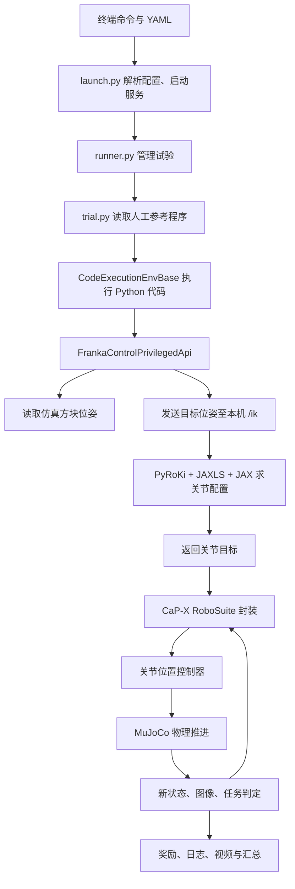

# CaP-X 当前环境与调用链：从参考程序到方块被提起

本文依据当前本地源码、Conda `capx` 环境和 `outputs/oracle/lift_oracle_10/summaries.txt` 整理。范围是已经跑通的 RoboSuite 特权状态参考程序，不代表 CaP-X 所有功能均已安装或验证。

## 1. 当前究竟做成了什么？

已经完成：创建 Franka Panda 仿真环境、生成相机图像、启动本机 PyRoKi 服务、执行人工参考代码、控制机械臂抓取并提起方块、记录视频与任务结果。

10 次试验汇总：任务完成 10/10，平均奖励 1.0，每次一个代码块，无代码重新生成。该结果只描述当前任务和配置，不代表未知物体或新任务的成功率。

当前没有使用 LLM 生成程序，没有运行 VLA，没有训练任何模型，也没有完成 TAMP。图像被渲染和记录，但抓取目标位置直接来自仿真状态。

## 2. 下载、安装和使用是三件不同的事

- **下载源码：** 磁盘里有程序文件。
- **安装软件包：** 当前 Python 环境能找到相应包及依赖。
- **本次使用：** 程序实际调用该功能。

例如：LIBERO 源码已经通过 Git 子模块下载，但并未安装到本次环境，也没有在此次任务中运行。打开 `docs/libero-tasks.md` 只是阅读另一条环境路线。

### 仓库与子模块

| 下载的内容 | 作用 | 本次是否使用 |
|---|---|---|
| `cap-x/` | 实验配置、程序执行、机器人接口、模型交互及评测框架 | 是，从仓库根目录直接加载源码 |
| `capx/third_party/robosuite` | 机器人模型、桌面任务和控制器，连接 MuJoCo | 是，安装的 1.5.1 来自此目录 |
| `capx/third_party/LIBERO-PRO` | 另一套机器人任务及泛化评测环境 | 否，仅下载源码 |
| `capx/third_party/libero_dependencies/robosuite` | LIBERO 使用的另一份 RoboSuite | 否，不能与当前版本随意混装 |
| `capx/third_party/b1k` | BEHAVIOR 家庭场景任务相关代码 | 否，没有据此配置 Isaac Sim |
| `capx/third_party/sam3` | 文字提示分割等视觉感知代码 | 否，未安装相应分发包，本次未调用权重 |
| `capx/third_party/contact_graspnet_pytorch` | 根据点云等信息估计抓取姿态 | 否，本次采用固定抓取朝向 |
| `capx/third_party/curobo` | 运动学、碰撞及运动规划工具 | 否 |
| `capx/third_party/verl` | 后续语言模型强化学习相关框架 | 否 |
| 工作区的 `lerobot/` | 机器人数据、策略训练与推理框架 | 此次未接入 |
| 工作区的 `lerobot-kinematics/` | SO100/101 正逆运动学与控制示例 | 此次未接入，当前使用 Panda |

PyRoKi 和 JAXLS 则是通过固定 Git 提交安装到 Conda 环境的，不是本次新增的工作区子模块。

### Conda 环境中的主要组件

| 组件 | 当前版本／状态 | 负责什么 |
|---|---|---|
| Conda `capx` | Python 3.10 | 隔离本项目的解释器与依赖 |
| NumPy、SciPy | NumPy 1.26.4 | 数组、坐标及旋转计算 |
| MuJoCo | 3.5.0 | 模拟关节、接触、重力和物体运动 |
| RoboSuite | 1.5.1 | 定义 Panda、Lift 任务、控制接口、奖励和相机 |
| Gymnasium | 1.2.3 | 提供 `reset/step` 这类环境交互接口 |
| PyRoKi | 固定提交，包版本 0.0.0 | 构造机器人运动学模型并建立 IK 优化问题 |
| JAXLS | 固定提交，包版本 0.0.0 | 求解运动学中的非线性优化问题 |
| JAX / jaxlib | 0.4.29 | 数值计算、自动微分和 JIT 编译；当前配置为 CPU |
| JAXLie | 1.5.0 | 三维旋转、刚体变换相关数学 |
| robot-descriptions / yourdfpy | 1.22.0 / 0.0.60 | 获取并解析 Panda 的 URDF 机器人描述 |
| PyTorch / TorchVision | 2.8.0+cu128 / 0.23.0+cu128 | 后续神经网络计算基础；GPU 单独测试已通过，但本次没有训练或运行 VLA |
| NVIDIA CUDA pip 包 | 随 PyTorch 安装 | 为 PyTorch GPU 计算提供运行库，不等于 Isaac Sim，也不等于完整 CUDA 开发工具链 |
| FastAPI / Uvicorn / Pydantic | 已安装 | 定义、运行 IK 服务并校验请求格式 |
| requests | 已安装 | 向本机 IK 服务发送 HTTP 请求 |
| Tyro / PyYAML / OmegaConf | 已安装 | 解析命令行和 YAML 实验配置 |
| ImageIO / imageio-ffmpeg / Pillow | 已安装 | 保存视频、处理图像 |
| Open3D / Viser / Matplotlib | 已安装 | 几何、坐标变换、可视化及接口导入依赖；不能据此断言所有功能都在本次启用 |
| h5py | 3.15.1 | RoboSuite 相机工具模块导入时需要；此前漏装导致环境注册失败 |
| Mink | 1.1.0 | RoboSuite 其他控制路径的依赖；本次选用的关节控制不等于用它求 IK |
| OpenAI Python 包 | 已安装 | 为相关客户端代码提供依赖；安装包不代表已配置账户或发起模型调用 |

当前 `capx` 未作为 pip 分发包安装。运行 `python -m capx.envs.launch` 时，Python 从当前仓库目录找到 `capx/` 源码。

## 3. 当前启动配置是什么意思？

文件：[方块提起配置](./cap-x/env_configs/cube_lifting/franka_robosuite_cube_lifting_privileged.yaml)

核心内容：

```text
FrankaLiftCodeEnv                  外层：接收 Python 程序
franka_robosuite_cube_lift_low_level 内层：机器人与物理环境
privileged: true                  允许使用仿真真实状态
FrankaControlPrivilegedApi        暴露读取位姿、移动与夹爪函数
PyRoKi server, port 8116          本机逆运动学求解服务
```

命令行的 `--use-oracle-code True` 选择人工参考程序；`--total-trials 10` 选择重复次数；`--num-workers 1` 表示串行运行；`--record-video True` 启用录像。

`oracle` 在这里不是 AI 模型名字，也不是数据库软件，而是预先编写的参考解法。

## 4. 总体调用链



## 5. 从上到下逐步解释

### A. 启动入口

[launch.py](./cap-x/capx/envs/launch.py) 的 `main()` 读取配置，创建环境工厂，启动 YAML 中列出的服务，然后调用 `_run_headless_trials()`。

[runner.py](./cap-x/capx/envs/runner.py) 负责试验次数、环境创建、结果目录以及汇总。它自动启动 PyRoKi 子进程，等待 `127.0.0.1:8116` 可连接。

这里的 HTTP 通信是同一台机器上两个进程之间的通信，不是调用互联网大模型。

### B. 机器人描述加载

[launch_pyroki_server.py](./cap-x/capx/serving/launch_pyroki_server.py) 的 `init_pyroki_server()` 使用 `panda_description` 加载 URDF，以 `panda_hand` 为目标连杆，构建 PyRoKi 模型。

URDF 描述连杆、关节及其相互关系，让求解器知道“关节角改变后手会移动到哪里”。RoboSuite 的 MuJoCo 场景负责物理执行；PyRoKi 的模型负责运动学计算，两者承担不同工作。

启动日志虽然显示创建了碰撞球体模型，但本次 `/ik` 路径调用的是姿态 IK／带前次配置代价的 IK，不能据此宣称运行了完整避障规划。

### C. 取得参考程序

[trial.py](./cap-x/capx/envs/trial.py) 的 `_run_single_trial()` 检查 `use_oracle_code`：为真时直接读取 `env.oracle_code`，否则才进入模型查询分支。

人工程序原始定义在 [franka_lift.py](./cap-x/capx/envs/tasks/franka/franka_lift.py)。输出目录中的 `oracle_code.py` 是当次运行保存的副本，修改输出副本不会自动改变下次运行的原始程序。

即使输出中出现 `Generated program` 或保存了 `initial_prompt.txt`，也不意味着模型已经被调用。当前走的是 oracle 分支。

### D. 为什么程序能直接调用 `goto_pose()`？

[tasks/base.py](./cap-x/capx/envs/tasks/base.py) 的 `_init_exec_globals()` 把 API 对象提供的函数绑定到代码执行命名空间。

例如，把字符串名字 `goto_pose` 对应到 `FrankaControlPrivilegedApi.goto_pose` 方法。这样程序无需自行导入这些函数，也能直接调用。

外层 `step(action: str)` 接收一整段 Python 代码，调用 `_exec_user_code()`，用 `exec()` 执行，并收集 stdout、stderr 和执行结果。这是本地 Python 执行环境，日志中的 sandbox 字样不意味着已经启用了独立容器隔离。

### E. `sample_grasp_pose("red cube")` 是怎样找到方块的？

[control_privileged.py](./cap-x/capx/integrations/franka/control_privileged.py) 中，它读取 `obs["cube_poses"]["primary"]` 的位置，并返回固定抓取朝向 `[0, 0, 1, 0]`，四元数顺序为 WXYZ。

该位姿由 [robosuite_cube_lift.py](./cap-x/capx/envs/simulators/robosuite_cube_lift.py) 读取仿真物体状态，并转换到机器人基座坐标系。

所以本次的“red cube”实质是代码中的字符串匹配，不是语言模型理解，也不是 SAM3 分割。参考程序里的 `sample` 名字也不意味着当前路径运行了学习型抓取采样器。

### F. `goto_pose()` 如何变成关节动作？

```text
目标抓取位置 + 四元数
→ TCP 偏移修正：把抓取点转成求解目标连杆的位置
→ 必要时先添加接近位置，再到最终位置
→ _solve_and_move()
→ HTTP POST http://127.0.0.1:8116/ik
→ 求解并返回 joint_positions
→ 取出 7 个机械臂关节目标
→ move_to_joints_blocking()
```

HTTP 客户端在 [motion/pyroki.py](./cap-x/capx/integrations/motion/pyroki.py)。请求包含 `target_pose_wxyz_xyz`，以及可选的前次关节配置 `prev_cfg`。

服务端首次调用 `solve_ik()`，有前次配置时调用 `solve_ik_vel_cost()`。其目标包括末端姿态匹配与关节约束等；JAXLS 求解优化问题，JAX 执行数值计算。这里没有神经网络训练。

一个阅读细节：`goto_pose(..., z_approach=0.1)` 内部已经先移动到接近点，再移动到目标点。当前参考代码随后又调用一次相同目标的 `goto_pose()`，不是接近动作必需的第二步。

### G. 关节目标怎样让机器人真的动？

[robosuite_base.py](./cap-x/capx/envs/simulators/robosuite_base.py) 的 `move_to_joints_blocking()` 循环比较当前关节角与目标关节角，反复调用 RoboSuite 的 `step()`，直至误差足够小或达到步数上限。

本次控制配置 [panda_joint_ctrl.json](./cap-x/capx/integrations/robosuite/controllers/config/robots/panda_joint_ctrl.json) 使用 `JOINT_POSITION` 和绝对目标。控制器根据目标及实际状态计算控制量，MuJoCo 再推进物理状态。

注意：到达最大步数会结束等待，所以“函数返回”本身不保证一定精确到位。

**外层一步是执行一段程序，内层一步是推进机器人控制与仿真。** 一个外层代码块通常产生很多底层步进。

### H. 夹爪怎样抓住物体？

`open_gripper()` 与 `close_gripper()` 调用公共工具，设置夹爪动作并推进一定数量的仿真步。物体是否被夹住由仿真中的接触和运动结果决定，不是把“抓取成功”标志直接设为真。

参考代码最后把目标位置沿 Z 方向提高 0.1 米，再调用 `goto_pose()`。

### I. 谁判断成功？

不是 LLM，也不是视频识别。CaP-X 的 `task_completed()` 调用 RoboSuite Lift 的 `_check_success()`。

当前 [Lift 实现](./cap-x/capx/third_party/robosuite/robosuite/environments/manipulation/lift.py) 使用：

```python
cube_height > table_height + 0.04
```

也就是方块中心高度超过桌面高度 4 厘米。这个判定并不要求持续握持若干秒，也不评估未知任务泛化。

CaP-X 同时收集程序是否异常、环境奖励和完成标志。因此 `sandbox_rc=0` 与 `task_completed=True` 是两个不同指标：代码没报错不等于任务完成。

## 6. 输出文件怎么看？

当前结果目录：[lift_oracle_10](./cap-x/outputs/oracle/lift_oracle_10/)

| 文件 | 含义 |
|---|---|
| `summaries.txt` | 全部试验的汇总结果 |
| `oracle_code.py` | 当前使用的人工参考程序副本 |
| `trial_*/summary.txt` | 单次试验结果 |
| `trial_*/code.py` | 当次执行的代码 |
| `trial_*/video_combined.mp4` | 当次执行录像 |
| `prompts_and_responses/initial_prompt.txt` | 环境准备的任务和 API 提示；不证明已请求模型 |
| `all_responses.json` | 交互与执行记录 |
| `aaa_done_flag/aaa_done_flag.txt` | 批次完成标记，不应单凭它判断每次任务成功 |

`outputs/oracle/` 中的 oracle 是运行模式标识，所以实际目录与命令提供的目录相比多了一层。

## 7. 为什么安装了 GPU 软件，却把 JAX 设为 CPU？

不同组件可以使用不同计算设备。本次 PyRoKi/JAX 在 CPU 求解，MuJoCo 负责物理推进，EGL 支持离屏渲染；PyTorch GPU 计算已经单独验证，但此次没有深度策略推理或训练。

安装了 CUDA、PyTorch 和视觉工具，不意味着每次运行都调用它们的全部功能。

## 8. 已完成与后续研究的界线

```text
当前：人工程序 + 仿真状态 → IK → 传统控制 → 仿真 → 奖励

下一阶段：LLM 生成程序 + 同样的状态和工具 → 比较代码决策能力

后续：加入真实感知误差、反馈恢复、VLA 技能与 TAMP 分工

再后续：用执行经验训练上层智能体，比较精简 harness 后的能力
```

目前最重要的收获是拥有一条已经验证的执行基线。后续可以一次只替换一个环节，判断效果变化来自模型、感知、规划还是控制。
